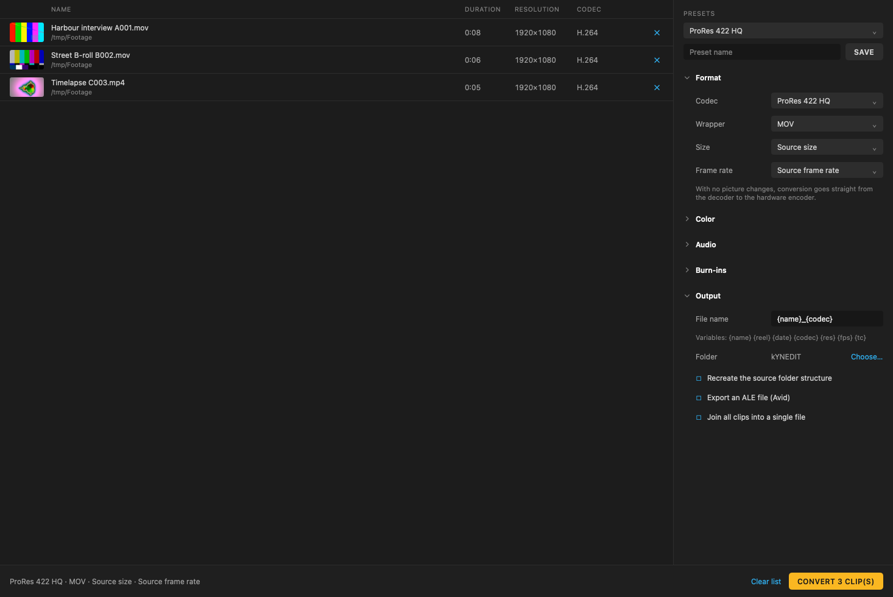

# kYNEDIT

A personal, simplified, high-performance macOS media browser and transcoder: Kyno-style browsing, tagging and subclips, EditReady-style fast transcoding, and export to DaVinci Resolve, Final Cut Pro and Premiere Pro.

## About

kYNEDIT is made by Starbudweiser & Claude Code (Anthropic). Part of the **DESKTOP MAC TOOLKIT**. MIT License, © 2026 Starbudweiser. Provided as is, without warranty. Inspired by Kyno (Lesspain Software) and EditReady (Divergent Media), not affiliated with either. See "About kYNEDIT" in the app menu.



## Features

- Folder browser with incremental indexing (SQLite, full-text search), thumbnails, grid and list views.
- Ratings, colour labels, keywords, notes, markers and subclips, all stored in a local catalogue (source files are never modified).
- Convert tab (EditReady-style): about 60 built-in presets (editing, proxies, Avid, delivery, dailies, camera log to Rec.709) and your own; ProRes (all variants), DNxHR/DNxHD (MOV, MXF OP1a, MXF OP-Atom), H.264, H.265; resize, frame rate, audio track/channel choice, LUT, log to Rec.709 (ARRI, Sony, Panasonic, Canon, Blackmagic, RED), burn-ins (timecode, reel, name, date, text, PNG logo), renaming templates, source folder structure, ALE export. Fastest path: decoded frames go straight to the hardware encoder; picture changes run on the GPU.
- Workshop tab: large viewer and quick tools. Lossless trimming (no re-encode): I / O set in and out points, Return adds the trim to a list, Cmd+S exports the current clip, Shift+Cmd+S exports the whole list; also still frame and audio-only extraction.
- Offload tab (Kyno-style): verified copy to up to 4 destinations, MD5 check of every copy, incremental, MHL hash list.
- Explorer extras: resolution and frame rate filters, batch renaming, CSV shotlist, marker stills.
- RAW: Blackmagic RAW and RED R3D (CPU and Metal GPU decode) through the manufacturers' SDKs, which are not part of this repository.
- Exchange files for DaVinci Resolve and Final Cut Pro (FCPXML 1.11) and Premiere Pro (xmeml; import not yet tested).
- Automatic updates from GitHub releases (Developer ID signature checked, never during an export). Languages: French, English, Spanish, Italian.

## Build

```bash
./build.sh [version]     # builds, signs and installs ~/Applications/Applications Personnelles/kYNEDIT.app
./release.sh <version>   # builds, notarises, tags and publishes a GitHub release
```

RAW support needs the SDKs placed in `vendor/` (git-ignored): `BlackmagicRawAPI.framework` and `R3DSDK`. Without them the app builds and RAW files are listed but not decoded.
